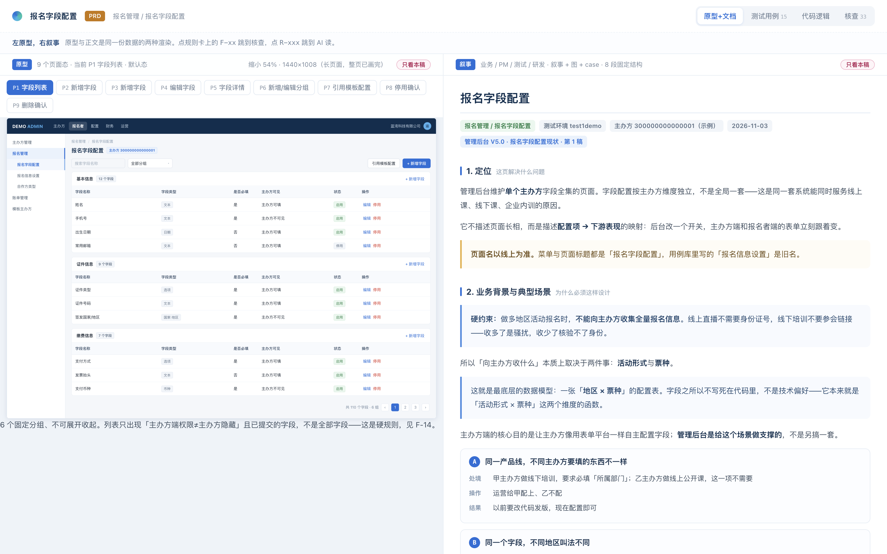
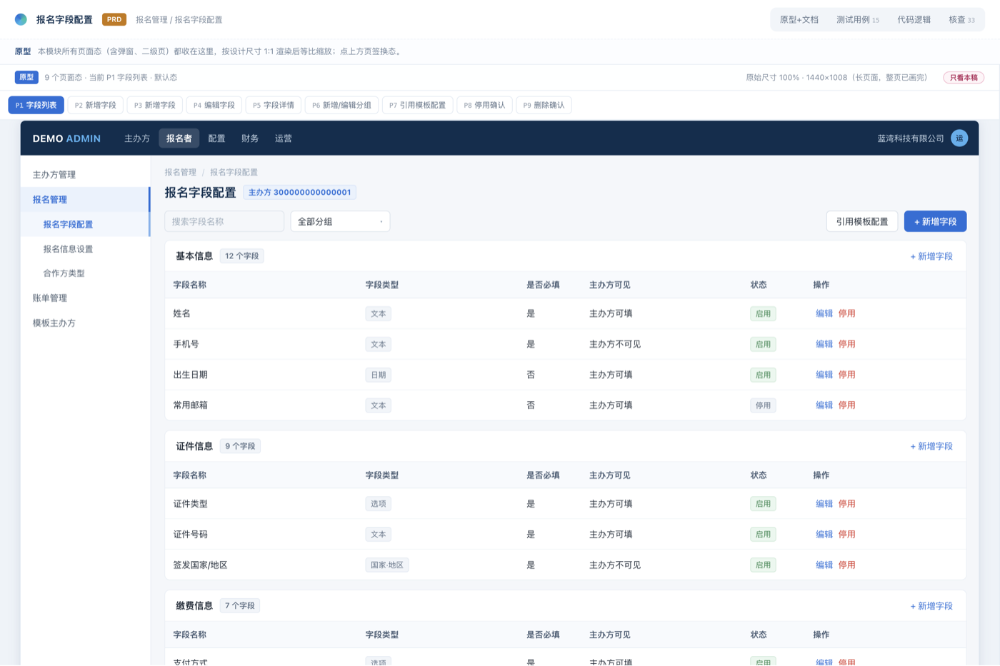
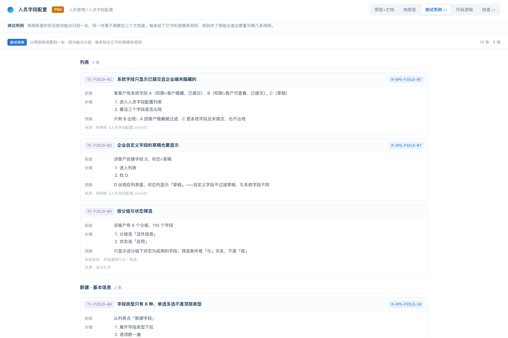
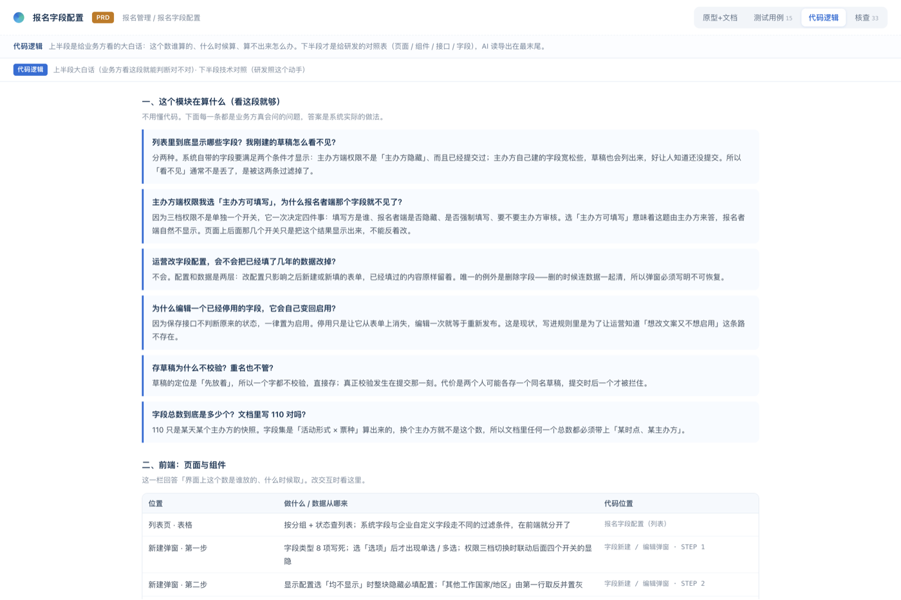
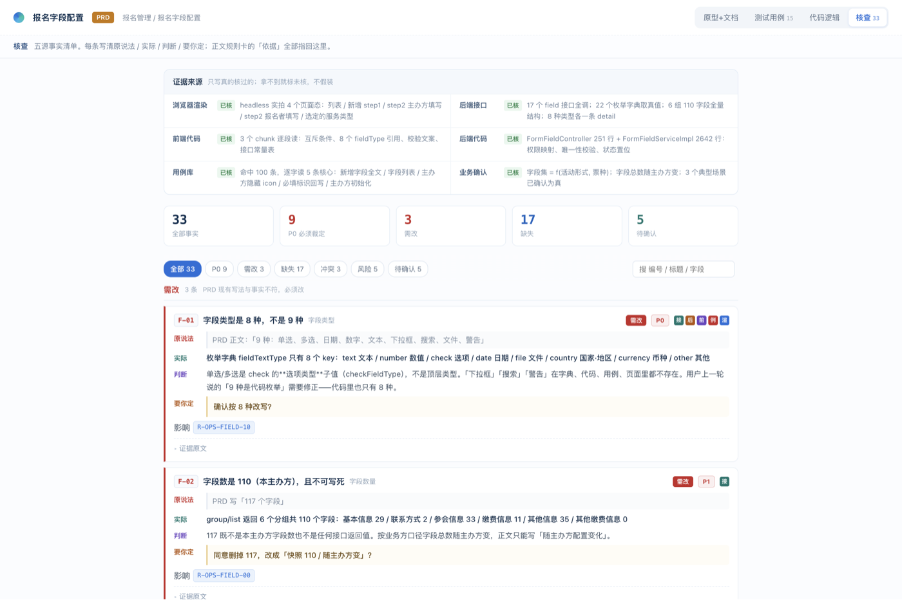
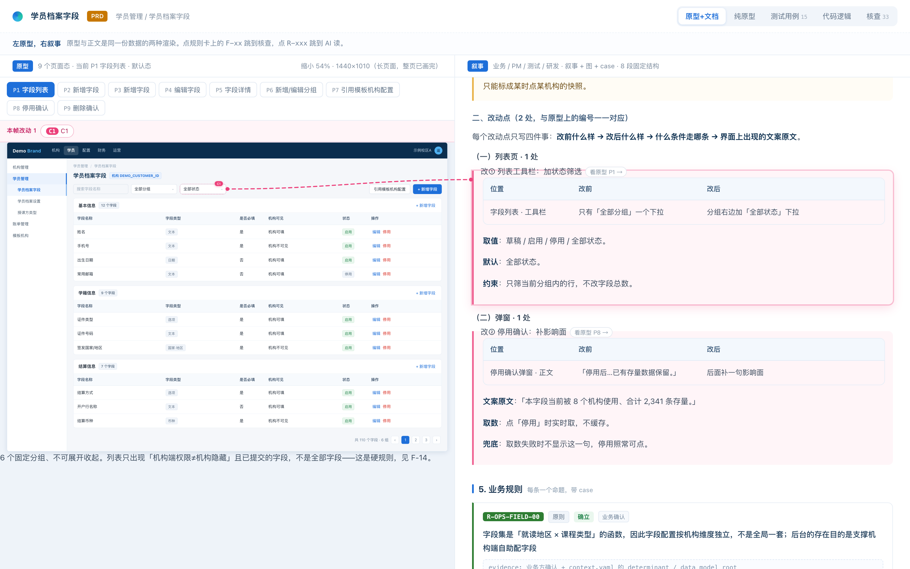

# system-to-prd

**A PRD that can prove itself.** ｜ 一份能自证的 PRD。

`Capture · 取证` ｜ `Evolve · 演进` ｜ `Merge · 收敛`

> **AI 来了，所有人都在问：新的产研协同到底长什么样。**
> 卡点不在模型，在于产品、测试、技术的信息从来不在同一个地方——就算都在，也对不齐。产品文档尤其乱，图和文对不上号。
> 与其缝缝补补，不如推倒重来：用 AI 重写一套 PRD 的模板。以后写 PRD 不是填 Excel、不是用在线文档工具，而是**直接跟 AI 对话，把它迭代出来**。
>
> *Most PRDs are written from memory. This one is written from evidence.*

**[English](#en) ｜ [中文](#zh)**　·　[as-is PRD](./docs/demo-prd.html)　·　[Draft 2 with change marks](./docs/demo-iteration.html)

[](./CHANGELOG.md)
[](https://www.python.org/)
[](./scripts)
[](./LICENSE)
[](./SKILL.md)



<a id="en"></a>

## Why this exists

Everyone says AI can write a PRD now. In practice it writes **system logic** — fluently, confidently, and from a single source. That is not where the truth lives.

The truth about a working product is scattered across six places that never talk to each other:

- what the page **actually renders** (including the dialog nobody documented)
- what the API **actually returns** (the enum has 8 values, not the 9 written in the doc)
- the **front-end branch** nobody tested
- the **back-end rule** nobody wrote down
- what **QA actually verified** (versus what the case file claims)
- what the **last PRD** said, two years ago, somewhere on Confluence

No single document has ever held all of that. A human cannot hold six sources in their head at once, so every PRD ends up being a partial memory of the system — written by whoever happened to be looking that day.

Models are only now strong enough to read all six and reconcile them. This project exists to do that one job properly, and then to keep doing it, draft after draft.

## The scenario, in four steps

```
① Capture    live system + test cases + code repo  →  six-source fact ledger
② Render     one master PRD: prototypes, narrative, cases, code, evidence
③ Evolve     talk to it: "add a column for X"      →  Draft 2, changes in pink
④ Merge      six people, six modules               →  one consolidated PRD
```

**① Capture.** Point it at your test environment. It logs in, clicks every dialog, submits the form for real, screenshots the pages — then reads the front-end and back-end code and cross-checks the test-case library. Anything backed by two or more sources becomes a fact; anything from a single guess gets an ID and goes into *pending confirmation*, never into the body text.

**② Render.** One self-contained HTML file: reconstructed prototypes, an 8-section narrative, test cases, code logic, and the fact ledger. See the six figures below.

**③ Evolve.** You stop writing PRDs. You **talk to this one**: *"this version adds a per-participant visibility column"* → it produces Draft 2 with the change marked in pink, anchored, numbered. The draft number is bound to the change, so an edit invalidates the sign-off automatically.

**④ Merge.** Six people each take one module, then merge into a single consolidated PRD — one numbering scheme, one source of truth.

## What you get — one file, four lanes, plus a second draft

### 1 · Prototype + narrative — the lane business stakeholders read
*原型 + 文档：左边是系统长什么样，右边是它为什么这样、要改成什么样。技术细节在这一栏不出现。*


### 2 · Prototype only — every page state, whole page in one frame
*原型单栏：9 个页面态（含全部弹窗、二级页）各一帧。这些帧不是画的，是从真实页面抓的快照转出来的，每帧带 `from` 指回快照，验收会查那个文件在不在——编不出来。*



### 3 · Test cases — grouped by feature, each pinned to the rule it guards
*测试用例栏：用例库里的条目按功能点归并，每条挂到它守的那条规则上；规则一改，能反查出要重写哪几条用例。*



### 4 · Code logic — plain language on top, front-end/back-end map below
*代码逻辑栏：上半段是给人读的大白话（这个数谁算的、什么时候算、算不出来怎么办），下半段才是给研发的对照表。接口地址、字段名、枚举值不是被删了，是被搬到这里。*



### 5 · Evidence — 33 facts, every one traceable to a source
*核查栏：事实清单。每条写「原说法 / 实际是什么 / 要不要按这个改」，标 P0 的必须由人裁定才能出定稿。*



### 6 · Draft 2 — changes in pink, anchored, numbered
*迭代态：第二稿。粉色虚线框 + 徽标 = 本稿改动，编号可点、可跳转、可发链接指到具体一处。*



## Why it's different

GitHub already has hundreds of PRD tools. Almost all of them take an **idea** as input.

| | Typical PRD skill | system-to-prd |
|:--|:--|:--|
| Source of truth | your prompt, your memory | the running system + code + test cases |
| Prototype | drawn by the model | captured, with a pointer proving it |
| Technical detail | mixed into the body | moved to its own lane |
| A wrong claim | undetectable | fails the gate |
| Second version | regenerate from scratch | Draft 2, change-marked, anchored |
| Six modules | six documents | one consolidated PRD |

## Bring your own sources

The reference workflow reads test cases from a knowledge base and code from a code host. Those are **two examples, not two requirements**.

| What you have | How it gets read |
|:--|:--|
| Notion · Feishu · Yuque · Confluence · TestRail · any searchable knowledge base | connector, if one exists |
| an `.xmind` · `.md` · `.csv` · `.xlsx` sitting in a folder | read straight from disk |
| GitHub · GitLab · self-hosted Git · a local clone | code-host CLI, or `harvest.py be --local <path>` |
| nothing but a browser and a person who remembers | ask them, and label the source as verbal |

What it will **not** do is pretend. A source it could not read is marked with a status and a reason, and the deliverable states how many sources it actually verified: **≥4 is normal, 2–3 gets flagged at the top, 1 produces a single-source draft, 0 refuses to start.**

Recipe for wiring a new connector in 30 minutes — three hard requirements (read-only, idempotent, never stores credentials), a three-step acceptance test, and three integration levels — in [`references/sources-adapters.md`](./references/sources-adapters.md).

## Recommended setup

| Layer | Works with | Notes |
|:--|:--|:--|
| **Agent harness** | Codex · Claude Code · WorkBuddy · any agent that reads `SKILL.md` and can run shell | the scripts are the engine, the agent is just the driver |
| **Model** | **DeepSeek V4.1 Flash** — recommended: best cost/performance, and the environment this project is primarily verified on | stronger models work too and will only do better; nothing here depends on one vendor |
| **Browser** | Chrome with a debug port (`launch_chrome.py` starts one) | capture pages, take real screenshots |
| **Runtime** | Python ≥ 3.8, zero third-party dependencies | |

## Quick start

```bash
git clone https://github.com/ronchizhang/system-to-prd.git
cp -r system-to-prd ~/.claude/skills/          # or ~/.workbuddy/skills/
python3 ~/.claude/skills/system-to-prd/scripts/doctor.py
```

`doctor.py` prints one screen: what works, what doesn't. A `!` line means a missing enhancement (screenshots, code reading), not a blocker — the PRD still gets written.

Then, in a conversation:

> Run a PRD for "event registration / custom field configuration". Test env: `https://test1.example.com`, account: …

It stops and asks you **twice** — once with the fact ledger (approve line by line), once with the outline (section count, rule count, state count, what will *not* be covered). Skipping those two stops is how you get a rewrite.

## What it refuses to do

- **Only touches the test environment.** The host must carry a label starting with `test`, otherwise it exits non-zero. "It's fine, just run it" does not override this.
- **Never persists credentials** — asked on every run, written only to a `0600` temp file, audited before delivery.
- **Writes "unknown" instead of guessing.** The pending-confirmation list is part of the deliverable, not a defect.
- **No irreversible actions** — real transfers, real emails, deleting other people's data. If verification needs it, the row is marked *not performed + why*.
- **Refuses explanatory text drawn onto the prototype.** Test: *would this sentence appear in a screenshot of the product?* If not, it belongs in the narrative.

## Repository layout

```
SKILL.md                  agent entry point — when to trigger, how to run
INSTALL.md                install, self-check, team workflow
assets/
  module_prd.html         four-lane renderer (data-driven, do not edit)
  module.schema.json      data contract, human-readable
  example_module.json     complete fictional sample — as-is PRD
  example_iteration.json  the same module as Draft 2, with change marks
references/               18 deep-dive docs
scripts/                  24 zero-dependency Python tools
docs/shots/               the screenshots above
tests/                    smoke tests, including "the gate must go red"
```

Zero third-party dependencies. Python ≥ 3.8.

---

<a id="zh"></a>

## 中文

**[English](#en) ｜ [中文](#zh)**

### 它为什么会出现

现在所有人都在说 AI 能写 PRD。但实际用下来你会发现：它写的是**系统逻辑**——写得很顺、很自信，而且只来自一个来源。

而真相不在任何一份文档里。一个跑着的产品，真相散在六个地方，彼此不说话：

- 页面**实际渲染**成什么样（包括那个没人写过的弹窗）
- 接口**实际返回**什么（字典里是 8 个值，不是文档里写的 9 个）
- **前端那条没人测过**的分支
- **后端那条没人记下**的规则
- **测试当初实际验的**是什么（用例文件上写的未必是）
- **两年前那份旧 PRD** 说过什么（在 Confluence 某个角落）

没有哪一份文档同时装得下这些东西。一个人也不可能同时把六个来源放在脑子里——所以每一份 PRD 都只是系统的**部分记忆**，由那天恰好在场的人写下。

直到现在，模型才第一次有能力把这六个来源全部读完并对齐。这个项目就是为了把这一件事做对，然后**一稿一稿地做下去**。

### 场景：四步

**① 取证** —— 把现有系统的测试环境、测试用例、代码仓库三处一起读，六源互证，出一份事实清单。两条以上证据支持的才写成事实；单源猜测进「待确认」，挂编号，不进正文。

**② 成稿** —— 产出一份全量的、最新的 PRD：原型 + 叙事 + 用例 + 代码栏 + 核查，一个单文件 HTML。原型不是画的，是从真实页面抓出来的。

**③ 迭代** —— 你不再「写」PRD，而是**对着这份 PRD 跟 AI 对话**：「这一版加一列报名者端可见」→ 它出第 2 稿，改动粉色标注、带编号、可锚点跳转，稿次跟改动绑死，改稿即失效。

**④ 收敛** —— 六个人各写一个模块，最后合成一份全量 PRD：一套编号、一份事实源。

### 上方六张图分别是什么

| 图 | 是什么 | 给谁看 |
|:--|:--|:--|
| **原型 + 文档** | 左原型右叙事，一屏对照 | 业务方 / 产品 / 审批人 |
| **原型单栏** | 9 个页面态各一帧，整页一帧 | 研发照着做，测试照着测 |
| **测试用例** | 按功能点归并，每条挂到它守的规则上 | 测试 |
| **代码逻辑** | 上半段大白话，下半段前后端对照 | 研发（上半段业务也能看） |
| **核查** | 33 条事实，每条追得到来源 | 所有人，尤其不想背锅的人 |
| **迭代态** | 第 2 稿，粉色 = 本稿改动 | 评审时所有人 |

### 用例库和代码仓不绑定任何产品

样本是从「能连知识库 + 能连代码托管」的环境里跑出来的，但那只是一种组合：

| 你手上是什么 | 它怎么读 |
|:--|:--|
| Notion / 飞书 / 语雀 / Confluence / TestRail / 任何可搜的知识库 | 有连接器就用连接器 |
| 一个 `.xmind`、`.md`、`.csv`、`.xlsx`，放在目录里 | 直接读文件 |
| GitHub / GitLab / 自建 Git / 本机 clone | 托管平台 CLI，或 `harvest.py be --local <路径>` |
| 只有一个浏览器，和一个记得住的人 | 问他，并把这一源标成「口述」 |

它**不会装作读过**。没读到的源会带状态和原因，交付里会写明这次到底核了几个源：**≥4 正常，2–3 顶部标出来，1 出单源稿，0 拒绝开工。**

接一个新连接器的最短路径（只读 / 幂等 / 不落凭据 三条硬要求 + 三步验收 + 三种接入方式）见 [`references/sources-adapters.md`](./references/sources-adapters.md)。

### 跑通需要的组合

| | 用什么 | 说明 |
|:--|:--|:--|
| **Agent 平台** | Codex · Claude Code · WorkBuddy，或任何能读 `SKILL.md` 并执行 shell 的 harness | 脚本是引擎，agent 只是司机 |
| **模型** | 推荐 **DeepSeek V4.1 Flash**——性价比最高，也是本项目主要验证的环境 | 更强的模型当然能跑，效果只会更好；这里不绑定任何一家 |
| **浏览器** | Chrome + 调试端口（`launch_chrome.py` 一条命令起） | 抓页面、实拍 |
| **运行环境** | Python ≥ 3.8，零第三方依赖 | 装完 `doctor.py` 一把过 |

### 三种用法

```text
# 1 · 现状 PRD：这个模块现在到底怎么跑
> 给「报名管理 / 报名字段配置」跑一份 PRD，测试环境 xxx，账号 xxx

# 2 · 迭代 PRD：在上一稿基础上出下一版
> 基于第 1 稿，这一版加「报名者端可见」列，改动标出来

# 3 · 合并：分模块做完收成一份全量
> 把这 6 个模块合并成全量 PRD
```

### 它拒绝做的事

只碰测试环境（host 里必须有以 `test` 开头的标签，否则非 0 退出）；凭据每次现要、不落任何文件；不知道就写不知道；不可逆动作不做，标「未实做 + 原因」；原型上不许写解释——判据是「这句话会不会出现在系统截图上」。

### 安装

见 [INSTALL.md](./INSTALL.md)。三步：clone → `doctor.py` 自检 → 开新对话说一句需求。

---

## Credits & scope

Built and battle-tested on real internal back-office systems. All company names, customer records, endpoints, product lines and logos in this repository have been replaced with fictional ones; `assets/example_module.json` and `assets/example_iteration.json` are a self-consistent fictional demo (an event-registration field-configuration module, Draft 1 and Draft 2).

Use it only on systems you are authorized to access.

## License

MIT — see [LICENSE](./LICENSE).
